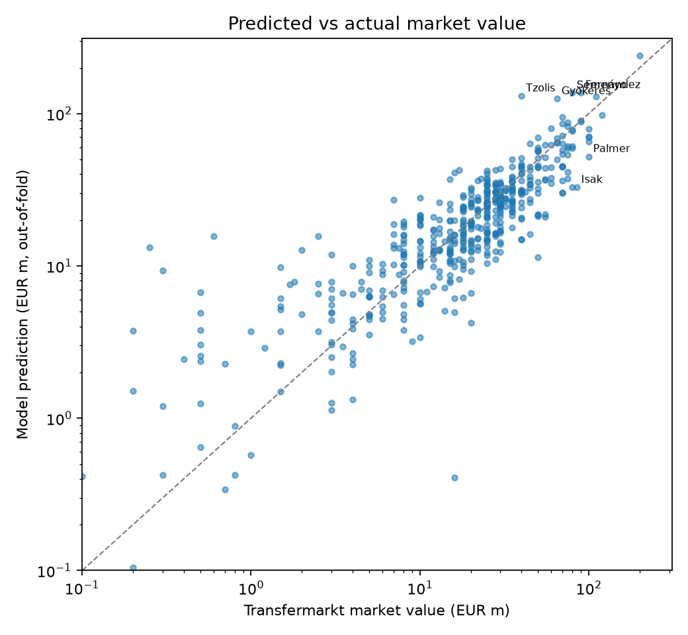

# ⚽ Premier League Player Market-Value Predictor

Predicts a Premier League player's **Transfermarkt market value** from last season's performance, minutes played, age, club strength, contract length and international caps, then tests whether **World Cup 2026 performance** adds any signal.

Built with Python, pandas and scikit-learn. Data comes from the football-data.org API and the public Transfermarkt dataset on Kaggle. Includes a Streamlit demo, an ablation study, out-of-fold evaluation, prediction intervals and a test suite.



## Results

<!-- RESULTS:START -->
Run `python -m plvalue train` and then `python -m plvalue readme` to fill this section.
<!-- RESULTS:END -->

All figures are **out-of-fold**: each player is predicted by a model that never saw them during training. The target is `log(1 + value)`, because values are heavily right-skewed.

## What I found

The numbers below are from earlier iterations of this project (see the ablation table above for the current model).

- **Minutes played mattered far more than goals.** Adding season minutes, starts, contract years left and international caps lifted cross-validated R² from about 0.56 to about 0.74. The free API only exposes goals and assists, so without minutes the model could not tell a starting keeper from a backup at a rich club.
- **World Cup performance added nothing once the other features were in.** R² was 0.741 with and without the World Cup features. Earlier, a "was in a World Cup squad" flag looked useful, but only because it stood in for "good enough for a national team", which minutes and caps capture directly.
- **Early overvaluation of veterans came from a too-gentle age curve.** A 32-year-old midfielder was predicted at €63m against an actual €35m. Hinge terms for age over 28 (and a goalkeeper-by-age interaction) fixed most of it.
- **Where it still fails:** young high-potential players (valued on potential, which stats can't show) and the very top of the market (the linear model keeps extending the line past what Transfermarkt pays).

## Quick start

```bash
git clone <this repo> && cd pl-value-predictor
python -m venv venv && source venv/bin/activate
pip install -r requirements.txt

cp .env.example .env            # then paste your football-data.org token into .env
```

1. Download the Kaggle dataset [`davidcariboo/player-scores`](https://www.kaggle.com/datasets/davidcariboo/player-scores) and copy `players.csv`, `player_valuations.csv` and `appearances.csv` into `data/raw/`.
2. Run the pipeline:

```bash
python -m plvalue probe      # check which API endpoints your plan can reach
python -m plvalue fetch      # football-data.org -> data/processed/stats.csv
python -m plvalue build      # match players to Transfermarkt -> values.csv + tm_features.csv
python -m plvalue train      # cross-validate, ablation study, save model + reports
python -m plvalue errors     # biggest over- and under-valuations
python -m plvalue predict --name "Bukayo Saka"
python -m plvalue readme     # paste the latest results into this README
streamlit run app.py         # interactive demo
```

Run the tests (no API key or Kaggle data needed, they use synthetic data):

```bash
pip install -r requirements-dev.txt && pytest -q
```

## How it works

```
football-data.org API ──fetch──► stats.csv ─┐
                                            ├─ build ─► values.csv (target)
Kaggle / Transfermarkt ─────────────────────┘          tm_features.csv (minutes, contract, caps)
                                                              │
                                    train ◄───────────────────┘
                                      │
              model.joblib · metrics.json · pred_vs_actual.png · results.md
```

- **Player matching.** The two sources spell names differently (`Thiago` vs `Igor Thiago`, `Sávio` vs `Savinho`), so players are matched on exact name, then on **date of birth plus fuzzy name similarity**. Same-name matches whose birth dates are 5+ years apart are rejected as different people, and duplicate records for one person are collapsed.
- **Features**, grouped so they can be ablated: age (with hinge terms and a goalkeeper interaction), last-season league stats, club strength (last season's table position, points, goal difference), season activity (minutes, starts, per-90 output), contract and caps, position, and World Cup involvement.
- **Models.** Linear regression is the main model (interpretable weights). Ridge and gradient boosting are trained for comparison.
- **Evaluation.** 5-fold cross-validation, out-of-fold error by age band, and an 80% prediction interval built from out-of-fold residuals.
- **Ablation.** Each feature group is dropped in turn and the model retrained, so every claim about "what matters" is measured, not assumed.

## Limitations (please read)

- The target is **Transfermarkt's market value estimate, not actual transfer fees**. The model learns how that site prices players.
- The values in the Kaggle dataset **predate the 2026 World Cup**, so this project cannot show whether the tournament moved anyone's value. Testing that properly needs valuations from after the tournament. The pipeline is ready for it: rebuild with newer data and re-run `train`.
- The free API tier only provides goals, assists, penalties and matches played for the top 100 scorers. Defenders and keepers are therefore described mostly by minutes, age and club.
- About 503 of 567 players could be matched to a value. Unmatched players (mostly academy and reserve players) are excluded from training.
- "Start" is approximated as 60+ minutes played; real line-up data isn't available.

## Data sources and attribution

- Stats: [football-data.org](https://www.football-data.org/) (free tier). Check their terms of use before redistributing data.
- Valuations, appearances, contracts and caps: [Football Data from Transfermarkt](https://www.kaggle.com/datasets/davidcariboo/player-scores) by David Cariboo, scraped from Transfermarkt. Check the dataset's licence on Kaggle.
- Raw data is **not** included in this repository.

## Project layout

```
plvalue/
  api.py            football-data.org client (probe, fetch)
  transfermarkt.py  Kaggle loading, season features, player matching
  features.py       feature engineering, grouped for ablation
  model.py          training, out-of-fold evaluation, ablation, prediction, reports
  cli.py            python -m plvalue <command>
app.py              Streamlit demo
tests/              unit + end-to-end tests on synthetic data
reports/            metrics.json, results.md, pred_vs_actual.png, oof_predictions.csv
```

## Possible next steps

- Re-run with post-World Cup valuations to answer the original question properly.
- Add richer stats (xG, defensive actions) from a paid API or FBref.
- A separate model for goalkeepers and a model that handles the top of the market better.
